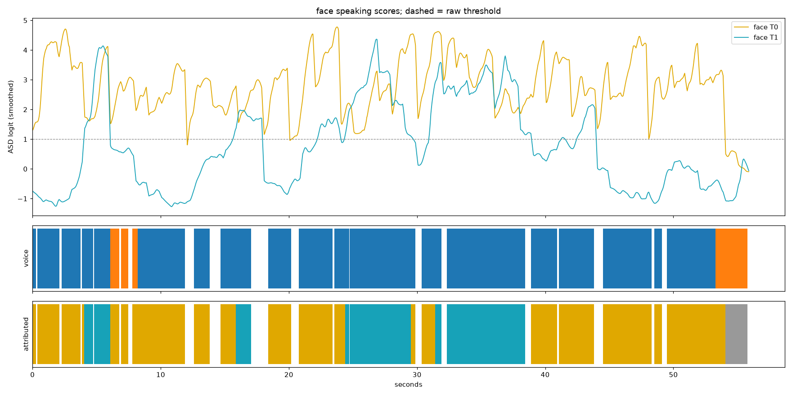

# whosaid

Offline speaker-locked captions. Given any video, it finds the faces, works out who is speaking when, separates
overlapping voices, transcribes each person's speech, and burns the words **under that person's own face**. The caption
follows the face; if the person leaves the frame it glides to the edge they left through and stays there. Speech in
other languages can be translated into English captions.

Everything runs locally on CPU. No API calls, no uploads.

## Demo

Original clip on the left, the same clip captioned by whosaid on the right (a TV studio sketch: wide shot, then close-ups
that cut between three people). Each line sits under whoever says it, and a line spoken while the camera shows someone else
becomes an off-screen caption. If the player does not load, open [docs/demo/side_by_side.mp4](docs/demo/side_by_side.mp4).

<video src="https://github.com/brinzunza/whosaid/raw/main/docs/demo/side_by_side.mp4" controls muted playsinline width="100%"></video>

```bash
uv run whosaid sportsdebate.mp4 --whisper-model medium --language en
```

The clip is third-party content used only to illustrate the tool; it is not covered by this repository's license.



*Debug timeline for one clip (`whosaid inspect`): the two curves are each face's speaking score, the bottom bar is
who each word was finally credited to (grey = nobody visible said it).*

## Quick start

Needs Python 3.12, [uv](https://docs.astral.sh/uv/) and `ffmpeg`/`ffprobe` on the PATH.

```bash
uv sync
uv run whosaid clip.mp4                      # -> clip.captioned.mp4 (+ clip.captioned.json)
uv run whosaid clip.mp4 --translate-to en    # other languages -> English captions
uv run whosaid clip.mp4 --caption-style box  # dark box with the whole line instead of outlined words
uv run whosaid clip.mp4 --debug              # also draw face boxes with live speaking scores
uv run whosaid clip.mp4 --whisper-model medium --language en
uv run pytest
```

Whisper weights and the Dolphin extractor download on first use. The face detector (`models/yunet.onnx`) and the
speaking-detector weights ship in `models/`. Expect roughly 2.5 s of CPU time per second of video when overlapping
voices have to be separated; heavy stages are cached in `<output>.work/`, so re-runs after changing attribution or
layout take seconds. `uv run whosaid inspect clip.mp4 --workdir out/clip.work --plot t.png` shows per-word evidence.

## How it works

1. **Faces**: OpenCV YuNet at 25 fps (handles turned and profile faces) and an IoU tracker with gap interpolation (`faces.py`).
   Shot cuts are detected and tracks never link across them, so a close-up of someone new in the same spot is a new person;
   a speaker whose shot ended is not carried onto the next shot (their words become an off-screen caption).
2. **Who is speaking**: LR-ASD, a 0.84 M-parameter audio-visual detector, scores each face per frame from lower-face crops and
   MFCCs (`asd.py`, `lrasd/`). Scores are calibrated per face (`calibrate.py`), because some faces look "talking" regardless.
3. **Separating voices**: when two on-screen faces are scored as speaking at the same time for a few seconds, Dolphin (an audio-visual extractor driven by lip crops)
   pulls each face's voice out of the mixture, and each voice is transcribed on its own (`separate.py`, `lips.py`, `dolphin/`). Clean turn-taking skips this step (`--separate off|auto|on`): it is two thirds of the
   run time and its leaks can hurt a clip where nobody talks over anyone.
4. **What was said**: faster-whisper with word timestamps; per-voice language detection and optional translation (`asr.py`, `translate.py`).
5. **Attribution**: each word goes to the face whose voice produced it or whose speaking score clears the threshold;
   words nobody on screen accounts for become off-screen captions. Leaked duplicates between stems are removed (`attribute.py`, `pipeline.py`).
6. **Layout and render**: captions anchored below faces, clamped to the frame, pushed apart when they overlap,
   words appearing as spoken (`layout.py`, `render.py`).

Optional, off by default: score fusion with extracted-voice energy (`fusion.py`), a head-only fine-tuned detector
(`asd_head.py`), photo/poster filtering (`photos.py`, `--static-filter on`), and the lip-voice sync scorer (`sync.py`).

## Measuring it

Real footage has no ground truth for "who said which word", so the repo builds its own. `whosaid synth` composites
single-person clips into scenes (single speaker, turn-taking, overlapping speech, off-screen speaker; listeners either
freeze or mouth along silently) with exact labels, split by *person* into train / val / test. `whosaid bench` scores a
run with **cpWER**, a word error rate that also penalises crediting a word to the wrong speaker.

Data used here: 15 one-minute clips of 11 people, composited into 121 scenes (66 train, 15 val, 40 test).
Protocol: tune on dev (val + train), run test once.

| | cpWER, 12 held-out test scenes |
|---|---|
| first baseline (every face separated) | 57.2 % |
| separation on for every scene with two faces (`--separate on`) | **47.5 %** |

The 47.5 % was measured before the `auto` overlap gate existed. With the gate, dev cpWER moved 41.8 -> 42.6 % (scenes that
lost separation: 24.6 -> 26.2 %), the price for fixing real clips of clean turn-taking such as TV studio cuts, where
extracted voices leaked words to the wrong person.

These are numbers on synthetic scenes built from a small set of people, and the reference transcripts are Whisper on the
clean audio. They show relative progress, not production accuracy. Remaining errors: stem leakage between extracted
voices, off-screen speakers (~72 % cpWER) and ~55 % word recall inside overlapping speech.

### Experiments that did not move the end-to-end number

Four attempts to improve the attribution signal each helped a frame-level metric but not word-level cpWER, because the
dominant errors are decided by extraction quality, not by the speaking score.

| experiment | frame level | end to end |
|---|---|---|
| learned decision model instead of hand rules (`decide.py`) | oracle headroom is large | best learned 46.5-47.5 % vs rules 46.0 % |
| head-only fine-tuned speaking detector (`asd_head.py`) | test AUC 0.831 -> 0.889 | cpWER 48.4 vs 47.5 % |
| score calibration (`calibrate.py`) | removes detector-scale sensitivity | neutral (per-face valley hurts) |
| fuse extracted-voice energy into the score (`fusion.py`) | test AUC 0.747 -> 0.880 | dev cpWER 46.3 vs 45.8 % |

### Small lip-to-voice sync scorer (`sync.py`)

A 0.13 M-parameter network trained from scratch in about 25 minutes on CPU to judge whether a mouth and a sound belong
together: SyncNet-style per-frame embeddings, a lag-similarity head, a dense contrastive loss, and shifted-audio /
mouthing-listener negatives. Result, honestly: alone it is weaker than the pretrained detector (val AUC 0.72 vs 0.77;
a first version that saw the raw embeddings did no better), and against the hard case, a listener mouthing along while
someone else talks, every model here is near chance (0.54-0.60 AUC). Fused with LR-ASD through a logistic regression
fit on the train scenes it adds a small, consistent gain:

| frame-level AUC | all negatives | vs mouthing listener |
|---|---|---|
| LR-ASD, val (15 scenes) | 0.766 | 0.541 |
| LR-ASD + sync, val | 0.782 | 0.567 |
| LR-ASD, test (40 scenes, run once) | 0.854 | 0.599 |
| LR-ASD + sync, test | 0.864 | 0.615 |

It is not wired into the pipeline: earlier experiments showed frame-level gains of this size do not change word-level
cpWER, and with 6 training identities the scorer overfits (aligned-vs-shifted AUC 0.82 on train windows, 0.65 on val).
More single-speaker footage is the likely bottleneck.

```bash
uv run whosaid asd build                  # frame-level training arrays from the synthetic scenes
uv run whosaid sync train --out models/sync_lag.pt
uv run whosaid sync eval --model models/sync_lag.pt --prefix test_
```

## Repository layout

```
src/whosaid/   pipeline, faces, asd, asr, attribute, layout, render, separate, voices, translate, photos
               calibrate, fusion, decide, asd_train, asd_head, sync   (experiments)
               synth/ (scene generator), bench.py (scorer), inspect.py (debug plots), disk.py (free-space guard)
               lrasd/, dolphin/                                       (vendored third-party models)
models/        face detector, speaking-detector weights, small fusion / calibration files
tests/         unit tests (uv run pytest)
```

Datasets, generated scenes, caches and videos are not in the repo (`data/`, `out/` are git-ignored). Long jobs refuse
to run when free disk is low (`whosaid storage`, `WHOSAID_MIN_FREE_GB`).

## Known limits

- Separation is imperfect: words leak between stems, Whisper errs on extracted audio, and voices of people who are not
  visible are only heard through the mixture.
- Cold runs are slow on CPU (voice separation is about two thirds of the time).
- Face re-identification across cuts is not implemented: a returning person gets a new track, and a person who talks
  while the camera shows someone else is captioned as off-screen rather than under their own face.
- Photos and video insets that look like faces can still be treated as people.
- Accuracy on real footage has not been measured against human labels.
- Translation quality follows Whisper: fine for common words, weaker on rare ones.

## Licenses and third-party code

Code in this repository (outside `lrasd/` and `dolphin/`): MIT, see `LICENSE`.

- `src/whosaid/lrasd/`: LR-ASD, https://github.com/Junhua-Liao/LR-ASD (MIT).
- `src/whosaid/dolphin/`: Dolphin audio-visual speech separation (Apache-2.0 code, see its `LICENSE`, `NOTICE`,
  `THIRD_PARTY_NOTICES.txt`). **The released Dolphin weights are not cleared for commercial use** (see
  `MODEL_PROVENANCE.txt`), so treat any output that uses separation as non-commercial.
- YuNet face detector (OpenCV Zoo, MIT), faster-whisper / Whisper (MIT), SpeechBrain ECAPA (Apache-2.0).
- Only use videos you have the right to process.
